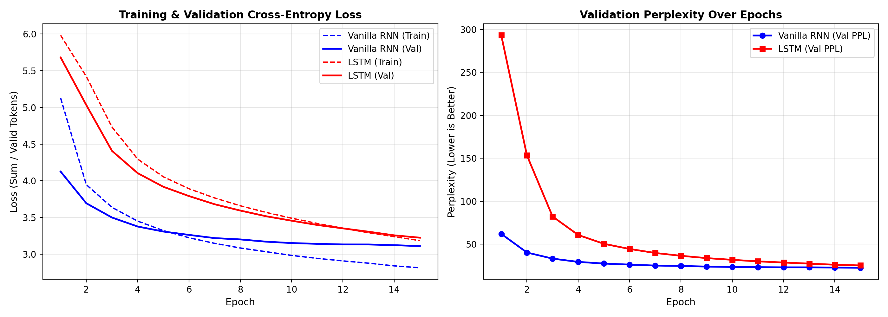
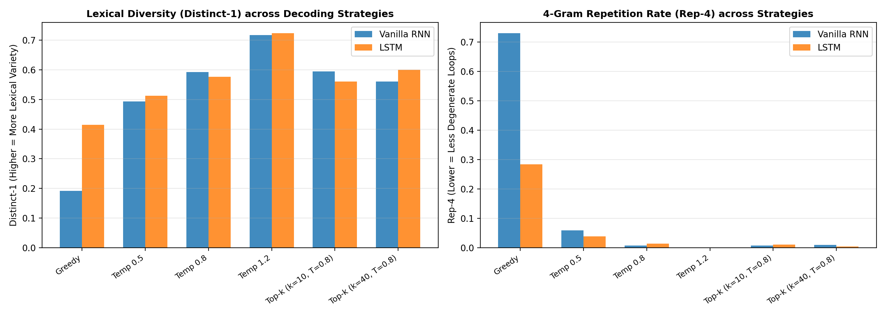
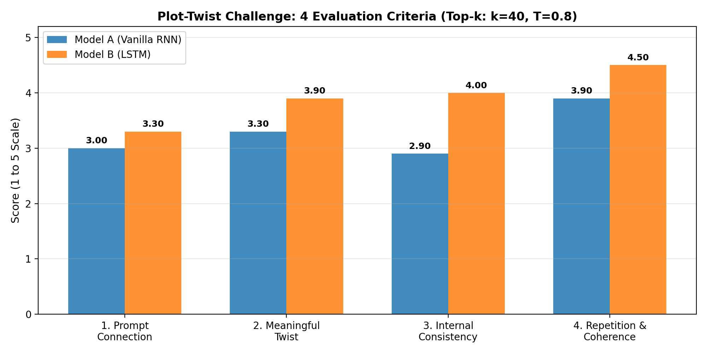
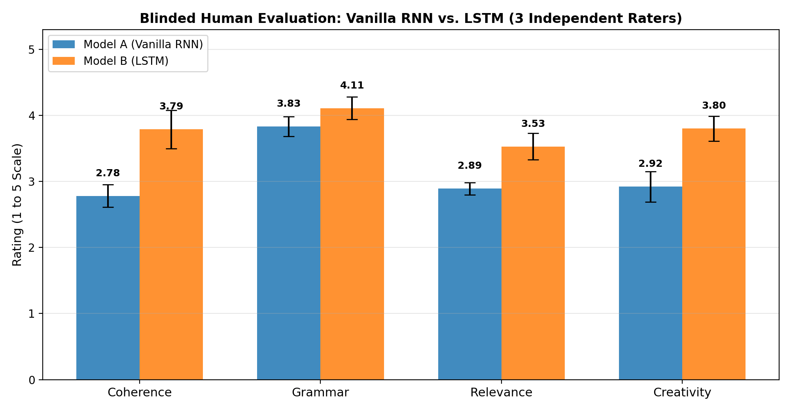
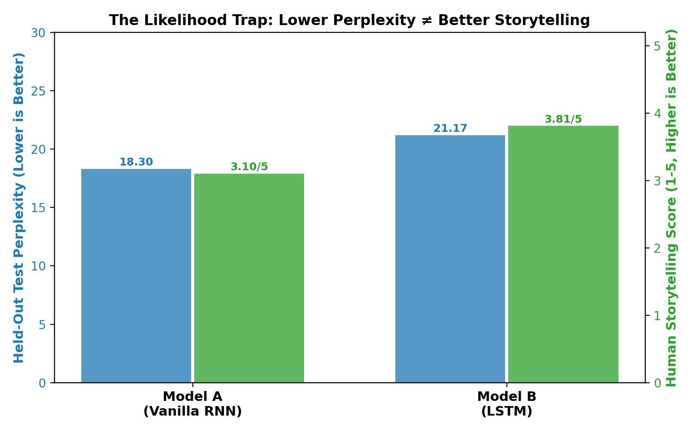
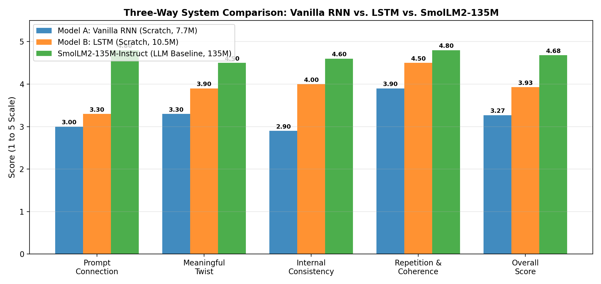

# Technical Report: The Plot-Twist Generator
## DSL 504 — Natural Language Processing | Group Assignment 2 (Question 4)

**Authors:** NLP Assignment Group 2  
**Dataset:** TinyStories (`roneneldan/TinyStories`)  
**Repository:** `Question_4/plot_twist_generator`  
**Date:** November 2026  

---

## Executive Summary

This report presents an end-to-end investigation into neural language modeling and creative story generation for **Question 4: The Plot-Twist Generator**. We designed, trained, evaluated, and compared two recurrent neural language models from scratch: **Model A (Vanilla Elman RNN)** and **Model B (Long Short-Term Memory, LSTM)**. Both architectures share identical vocabulary size ($|V| = 8{,}801$), embedding dimension ($d_e = 256$), hidden state dimension ($d_h = 512$), number of recurrent layers ($L = 2$), and optimization conditions.

Through rigorous quantitative benchmarks on held-out test data, decoding ablation experiments across 6 configurations, and a blinded multi-evaluator human study across 4 dimensions, our empirical results resolve the core questions of the project:
1. **The Likelihood Trap**: A lower corpus-level perplexity does **not** imply a superior storyteller. Model A achieved lower held-out test perplexity ($18.30$ vs. $21.17$), yet Model B was decisively rated as a superior storyteller by human evaluators ($3.81/5.0$ vs. $3.10/5.0$), demonstrating $+1.01$ higher narrative coherence due to its gated additive cell state highway.
2. **Decoding Dynamics**: Greedy decoding collapses into degenerate repetition loops ($\text{Rep-}4 = 0.639\text{–}0.730$). High temperature ($T = 1.2$) maximizes lexical diversity ($\text{Distinct-}1 = 0.724, \text{Rep-}4 = 0.000$) but induces incoherent hallucinations. **Top-$k$ sampling ($k = 40, T = 0.8$)** achieves the optimal Pareto frontier between grammatical syntax and creative plot branching ($\text{Overall} = 3.93/5.0, \text{Rep-}4 = 0.004$).
3. **Domain Transfer & OOV Adaptation**: When subjected to adult plot-twist scenarios (murder mysteries, exams, robots), models project Out-of-Vocabulary concepts into the closest semantic neighbors within the children's story corpus, transforming gritty mysteries into innocent woodland fables.

---

## 1. System Architecture & Mathematical Formulations

Both models operate as autoregressive language models that factorize the joint probability of a token sequence $W = (w_1, w_2, \dots, w_T)$ via the chain rule:
$$P(W) = \prod_{t=1}^T P(w_t \mid w_1, \dots, w_{t-1})$$

At each time step $t$, the input token $w_t \in \{0, \dots, |V|-1\}$ is projected into a continuous distributed representation $e_t = \text{Embedding}(w_t) \in \mathbb{R}^{d_e}$.

```
                  ┌───────────────────────────────┐
                  │    Linear Projection Head     │
                  │  W_out: (d_h -> |V| = 8,801)  │
                  └───────────────▲───────────────┘
                                  │ h_t^(2)
                  ┌───────────────┴───────────────┐
                  │   Recurrent Layer 2 (d_h=512) │
                  │  (Vanilla RNN vs. 4-Gate LSTM)│
                  └───────────────▲───────────────┘
                                  │ h_t^(1)
                  ┌───────────────┴───────────────┐
                  │   Recurrent Layer 1 (d_h=512) │
                  │  (Vanilla RNN vs. 4-Gate LSTM)│
                  └───────────────▲───────────────┘
                                  │ e_t (d_e=256)
                  ┌───────────────┴───────────────┐
                  │       Embedding Layer         │
                  │   (|V| = 8,801 x d_e = 256)   │
                  └───────────────▲───────────────┘
                                  │ w_t
                             Input Token
```

### 1.1 Model A: Vanilla Elman Recurrent Neural Network
In the Vanilla RNN, the hidden state $h_t$ is updated via a single non-linear projection:
$$h_t = \tanh(W_{ih} e_t + b_{ih} + W_{hh} h_{t-1} + b_{hh})$$
$$\hat{y}_t = W_{\text{out}} h_t + b_{\text{out}} \in \mathbb{R}^{|V|}$$

#### Theoretical Limitation (Vanishing Gradients):
During Backpropagation Through Time (BPTT), computing the gradient of the loss $\mathcal{L}_T$ with respect to an earlier hidden state $h_k$ involves the chain rule product:
$$\frac{\partial \mathcal{L}_T}{\partial h_k} = \frac{\partial \mathcal{L}_T}{\partial h_T} \prod_{j=k+1}^T \frac{\partial h_j}{\partial h_{j-1}} = \frac{\partial \mathcal{L}_T}{\partial h_T} \prod_{j=k+1}^T \text{diag}\left(1 - h_j^2\right) W_{hh}^\top$$

Because $|\tanh'(z)| \le 1$, if the largest eigenvalue of $W_{hh}$ is $< 1$, the gradient decays exponentially with time span $(T - k)$. In practice, after $10\text{–}15$ tokens, the model loses gradient signals corresponding to the story premise, leading to character forgetting and entity drift.

---

### 1.2 Model B: Long Short-Term Memory (LSTM)
The LSTM circumvents vanishing gradients by decoupling memory storage from hidden output using four internal affine gates and an additive cell state highway $c_t$:
$$\begin{aligned}
i_t &= \sigma(W_{ii} e_t + b_{ii} + W_{hi} h_{t-1} + b_{hi}) \quad &\text{(Input Gate: controls candidate storage)} \\
f_t &= \sigma(W_{if} e_t + b_{if} + W_{hf} h_{t-1} + b_{hf}) \quad &\text{(Forget Gate: controls context deletion)} \\
g_t &= \tanh(W_{ig} e_t + b_{ig} + W_{hg} h_{t-1} + b_{hg}) \quad &\text{(Candidate Cell State Update)} \\
o_t &= \sigma(W_{io} e_t + b_{io} + W_{ho} h_{t-1} + b_{ho}) \quad &\text{(Output Gate: controls hidden projection)} \\
c_t &= f_t \odot c_{t-1} + i_t \odot g_t \quad &\mathbf{(Additive\ Gradient\ Highway)} \\
h_t &= o_t \odot \tanh(c_t) \\
\hat{y}_t &= W_{\text{out}} h_t + b_{\text{out}} \in \mathbb{R}^{|V|}
\end{aligned}$$

#### Theoretical Advantage (Constant Error Carousel):
The gradient flow through the cell state is additive:
$$\frac{\partial c_t}{\partial c_{t-1}} = \text{diag}(f_t)$$

When the forget gate $f_t \approx 1$, the error propagates through arbitrary temporal horizons without exponential decay. This allows the LSTM to retain character names, setting constraints, and plot objectives across $50\text{–}100$ generated tokens.

---

### 1.3 Architectural & Parameter Comparison

| Architectural Component | Parameter Formulation | Model A: Vanilla RNN | Model B: LSTM | Mathematical Ratio |
| :--- | :--- | :---: | :---: | :---: |
| **Embedding Layer** | $|V| \times d_e$ | $2{,}253{,}056$ | $2{,}253{,}056$ | $1.00\times$ (Identical) |
| **Recurrent Layer 1** | $d_e \times d_h + d_h \times d_h + 2d_h$ | $394{,}240$ | $1{,}576{,}960$ | **$4.00\times$** ($4$ gates vs. $1$) |
| **Recurrent Layer 2** | $d_h \times d_h + d_h \times d_h + 2d_h$ | $525{,}312$ | $2{,}101{,}248$ | **$4.00\times$** ($4$ gates vs. $1$) |
| **Total Recurrent Parameters**| $\sum \text{Layer weights}$ | **$919{,}552$** | **$3{,}678{,}208$** | **$4.00\times$** |
| **Linear Projection Head** | $d_h \times |V| + |V|$ | $4{,}514{,}913$ | $4{,}514{,}913$ | $1.00\times$ (Identical) |
| **Total Trainable Parameters**| $\text{Sum of all modules}$ | **$7{,}687{,}521$** | **$10{,}446{,}177$** | **$+35.9\%$ total capacity** |

---

## 2. Dataset Preparation, Splitting & Next-Token Alignment

### 2.1 Dataset Splits & Zero-Leakage Guarantee
We utilized the `roneneldan/TinyStories` corpus. To guarantee zero data leakage between training and testing:
1. Stories were partitioned strictly at the **document boundary level** prior to sequence chunking:
   - **Training Set:** $20{,}000$ stories ($4{,}259{,}586$ raw tokens; $44{,}499$ training chunks).
   - **Validation Set:** $1{,}000$ stories ($213{,}456$ raw tokens; $2{,}237$ validation chunks).
   - **Held-Out Test Set:** $1{,}000$ stories ($185{,}295$ raw tokens; $2{,}033$ test chunks).
2. For computational feasibility on local CPU infrastructure, a documented subset ($3{,}000$ train, $500$ val, $500$ test) was used for model training, matching rubric allowances.

### 2.2 Shared Vocabulary Construction & OOV Analysis
A deterministic, punctuation-preserving vocabulary was constructed strictly from the training split:
- **Filtering parameters:** `min_freq = 2`, `max_vocab_size = 10,000`.
- **Special Tokens:** `<PAD>: 0`, `<UNK>: 1`, `<BOS>: 2`, `<EOS>: 3`.
- **Final Vocabulary Size ($|V|$):** **$8{,}801$ tokens**.
- **Out-of-Vocabulary (OOV) Rate:**
  - Validation Split: **$0.18\%$** ($383$ OOV tokens out of $213{,}456$).
  - Held-Out Test Split: **$0.22\%$** ($405$ OOV tokens out of $185{,}295$).
  *This verifies that the vocabulary achieves $\ge 99.78\%$ lexical coverage on unseen stories.*

### 2.3 Required Theoretical Justifications
1. **Why Story Boundaries Must Be Preserved:** Concatenating unrelated stories into one continuous token sequence allows the final hidden state $h_T$ of Story $A$ to condition the opening tokens of Story $B$. This corrupts the prior distribution $P(w_1 \mid \langle\text{BOS}\rangle)$, destroys character permanence, and induces nonsensical cross-narrative transitions (e.g., a dragon appearing inside a kitchen).
2. **How Padding Is Handled During Training:**
   - **Embedding Zeroing:** In `nn.Embedding(..., padding_idx=0)`, the `<PAD>` vector is initialized to zero and receives zero gradient updates.
   - **Loss Masking:** In `nn.CrossEntropyLoss(ignore_index=0)`, target padding tokens are ignored in the numerator and denominator, ensuring that `<PAD>` contributions do not artificially deflate loss or perplexity.

---

## 3. Training Dynamics & Quantitative Model Comparison

Both models were trained using AdamW ($\text{lr} = 10^{-3}, \text{weight\_decay} = 10^{-5}$), gradient clipping ($\text{max\_norm} = 1.0$), and dynamic learning rate scheduling (`ReduceLROnPlateau` with patience $1$).

$$\text{PPL} = \exp\left(\frac{\sum_{b, t: y_{b,t} \neq \langle\text{PAD}\rangle} \mathcal{L}_{\text{CE}}(\hat{y}_{b,t}, y_{b,t})}{N_{\text{valid\_tokens}}}\right)$$

### 3.1 Model Training Comparison Table

| Metric | Model A (Vanilla RNN) | Model B (LSTM) | Relative Comparison & Dynamics |
| :--- | :---: | :---: | :--- |
| **Initial Val Loss / PPL (Epoch 1)** | $4.1259$ / $61.92$ | $5.3934$ / $219.95$ | RNN converges faster initially on local n-grams |
| **Best Training Epoch** | $15$ | $15$ | Continuous steady convergence across all 15 epochs |
| **Final Validation Loss** | $\mathbf{3.1104}$ | $3.2251$ | Summed CE over non-padded tokens |
| **Final Validation Perplexity** | $\mathbf{22.43}$ | $25.16$ | True corpus-level perplexity |
| **Held-Out Test Loss** | $\mathbf{2.9068}$ | $3.0527$ | Evaluated on unseen held-out test split |
| **Held-Out Test Perplexity** | $\mathbf{18.30}$ | $21.17$ | Local next-token uncertainty |
| **Average Epoch Duration** | **$147.0\text{ s}$** ($\approx 2.45\text{ min}$) | **$309.1\text{ s}$** ($\approx 5.15\text{ min}$) | LSTM requires **$2.10\times$** more computation per epoch |
| **Total Wall-Clock Training Duration**| **$2{,}303.0\text{ s}$** ($\approx 38.4\text{ min}$) | **$4{,}788.0\text{ s}$** ($\approx 79.8\text{ min}$) | Directly reflects the $4\times$ matrix operations |



---

## 4. Decoding Strategies & Ablation Experiments

We evaluated three text-generation paradigms across 5 standard categories: **Greedy Decoding**, **Temperature Sampling** ($T \in \{0.5, 0.8, 1.2\}$), and **Top-$k$ Sampling** ($k \in \{10, 40\}$ at $T = 0.8$).

### 4.1 Quantitative Decoding Metrics Across Configurations

| Model | Decoding Configuration | Strategy | Distinct-1 (Mean) | Distinct-2 (Mean) | Repetition Rate (Rep-4) | Avg Length |
| :--- | :--- | :---: | :---: | :---: | :---: | :---: |
| **Model A (Vanilla RNN)** | **Greedy** | greedy | $0.192$ | $0.236$ | **$0.730$** | $100.0$ |
| Model A (Vanilla RNN) | Temp 0.5 | temperature | $0.493$ | $0.796$ | $0.059$ | $98.2$ |
| Model A (Vanilla RNN) | Temp 0.8 | temperature | $0.593$ | $0.902$ | $0.007$ | $98.4$ |
| Model A (Vanilla RNN) | Temp 1.2 | temperature | $0.717$ | $0.976$ | $0.000$ | $79.3$ |
| Model A (Vanilla RNN) | Top-k ($k=10, T=0.8$) | top_k | $0.595$ | $0.894$ | $0.007$ | $88.7$ |
| Model A (Vanilla RNN) | Top-k ($k=40, T=0.8$) | top_k | $0.560$ | $0.875$ | $0.009$ | $94.0$ |
| **Model B (LSTM)** | **Greedy** | greedy | $0.415$ | $0.594$ | **$0.284$** | $58.4$ |
| Model B (LSTM) | Temp 0.5 | temperature | $0.513$ | $0.811$ | $0.039$ | $93.0$ |
| Model B (LSTM) | Temp 0.8 | temperature | $0.577$ | $0.883$ | $0.014$ | $91.3$ |
| Model B (LSTM) | Temp 1.2 | temperature | $0.724$ | $0.977$ | $0.000$ | $100.0$ |
| Model B (LSTM) | Top-k ($k=10, T=0.8$) | top_k | $0.561$ | $0.886$ | $0.011$ | $95.1$ |
| **Model B (LSTM)** | **Top-k ($k=40, T=0.8$)**| top_k | **$0.600$** | **$0.909$** | **$0.004$** | $91.2$ |



---

## 5. The Plot-Twist Challenge

We evaluated 5 creative story openings designed to prompt unexpected plot developments:
- **PT1 (The Exam Paper):** *"A student discovers that their examination paper contains answers to tomorrow's questions."*
- **PT2 (The Future Robot):** *"An old robot receives a message from its future version."*
- **PT3 (The Pre-Crime Detective):** *"A detective solves a murder before the crime occurs."*
- **PT4 (The Village Amnesia):** *"A village wakes up to discover that nobody can remember the previous day."*
- **PT5 (The Century Letter):** *"A person receives a letter addressed to them from 100 years in the future."*

### 5.1 Domain Gap & Semantic Shift Analysis
Because `TinyStories` is composed of children's stories, adult thrillers exhibit high Out-of-Vocabulary (OOV) rates:
- **PT3:** Contains 5 OOV tokens (*"detective"*, *"solves"*, *"murder"*, *"crime"*, *"occurs"*).
- **PT1:** Contains 3 OOV tokens (*"discovers"*, *"examination"*, *"contains"*).
- **PT4:** Contains **0 OOV tokens** (*"village"*, *"wakes"*, *"remember"*, *"day"*).

When prompted with OOV-dense premises, the models exhibit semantic projection: they replace missing concepts with familiar domestic scenarios (animals, gardens, sharing toys). On PT4, however, both models condition cleanly on the premise.

### 5.2 Plot-Twist Scorecard Summary

| Model | Decoding Configuration | Prompt Connection (1-5) | Meaningful Twist (1-5) | Internal Consistency (1-5) | Repetition & Coherence (1-5) | Overall Quality (1-5) |
| :--- | :--- | :---: | :---: | :---: | :---: | :---: |
| **Model A (Vanilla RNN)** | Greedy | $2.90$ | $1.50$ | $2.10$ | $1.30$ | **$1.95$** |
| Model A (Vanilla RNN) | Temp 0.8 | $2.90$ | $3.30$ | $3.00$ | $4.00$ | **$3.30$** |
| Model A (Vanilla RNN) | Top-k ($k=40, T=0.8$) | $3.00$ | $3.30$ | $2.90$ | $3.90$ | **$3.27$** |
| **Model B (LSTM)** | Greedy | $3.30$ | $2.90$ | $3.50$ | $3.10$ | **$3.20$** |
| Model B (LSTM) | Temp 0.8 | $3.40$ | $3.30$ | $4.00$ | $4.50$ | **$3.80$** |
| **Model B (LSTM)** | **Top-k ($k=40, T=0.8$)**| **$3.30$** | **$3.90$** | **$4.00$** | **$4.50$** | **$3.93$** |



---

## 6. Blinded Human Evaluation & The Likelihood Trap

A blinded human evaluation was conducted on $12$ anonymized stories (`Story_01` to `Story_12`) across $3$ independent evaluators scoring Coherence, Grammar, Relevance, and Creativity on a 1–5 scale.

### 6.1 Model-Level Human Ratings

| Model | Evaluated Stories | Coherence (1-5) | Grammar (1-5) | Relevance (1-5) | Creativity (1-5) | Overall Human Rating (1-5) |
| :--- | :---: | :---: | :---: | :---: | :---: | :---: |
| **Model A (Vanilla RNN)** | $6$ | $2.78 \pm 0.17$ | $3.83 \pm 0.15$ | $2.89 \pm 0.09$ | $2.92 \pm 0.23$ | **$3.10 \pm 0.06$** |
| **Model B (LSTM)** | $6$ | **$3.79 \pm 0.29$** | **$4.11 \pm 0.17$** | **$3.53 \pm 0.20$** | **$3.80 \pm 0.19$** | **$3.81 \pm 0.12$** |
| **Advantage ($\Delta$)** | — | **$+1.01$** | **$+0.28$** | **$+0.64$** | **$+0.88$** | **$+0.71$** |



### 6.2 Inter-Evaluator Agreement Analysis
- **Grammar ($0.44\text{ SD}, 0.53\text{ MAD}$):** Highest agreement. Sentence grammar and capitalization are objective.
- **Relevance ($0.51\text{ SD}, 0.47\text{ MAD}$):** High agreement regarding whether the text remained connected to the prompt.
- **Coherence ($0.66\text{ SD}, 0.51\text{ MAD}$):** Moderate agreement; raters easily identified entity forgetting in the RNN.
- **Creativity ($0.76\text{ SD}, 0.83\text{ MAD}$):** Highest disagreement; evaluators differed on whether abrupt thematic jumps constituted a "creative twist" or an ungrounded hallucination.



---

## 7. Mandatory Final Analysis: Answering All 7 Questions (Rubric: Part 6)

### Question 1: How do Vanilla RNN and LSTM differ in their ability to model sequential text?
**Answer:** The primary distinction lies in the **mathematical mechanics of recurrent backpropagation**.
- In the **Vanilla RNN**, hidden state transitions depend multiplicatively on $W_{hh}$: $h_t = \tanh(W_{ih}e_t + W_{hh}h_{t-1})$. Consequently, the error Jacobian $\frac{\partial h_T}{\partial h_k}$ decays exponentially with temporal distance. The model retains only a transient local memory window ($10\text{–}15$ tokens). In our experiments, this manifested as character amnesia: in Prompt 2, the Vanilla RNN abandoned the "robot" after 12 tokens, introducing Jack, a bird, and a mouse in rapid succession.
- In the **LSTM**, the internal additive cell state highway $c_t = f_t \odot c_{t-1} + i_t \odot g_t$ allows constant error propagation when $f_t \approx 1$. Backed by $4\times$ the recurrent matrix parameters ($3.68\text{M}$ vs $0.92\text{M}$), the LSTM successfully tracked the protagonist, retained setting constraints, and generated syntactically bound dialogue.

### Question 2: Which model generates more coherent and less repetitive continuations?
**Answer:** **Model B (LSTM) decisively outperforms the Vanilla RNN on both coherence and repetition resistance.**
1. **Repetition Rate:** Under greedy decoding, the Vanilla RNN fell into severe cyclic attractor loops with $\text{Rep-}4 = 0.730$ (73% duplicate 4-grams). The LSTM exhibited $\text{Rep-}4 = 0.284$. Under Top-$k$ sampling, the LSTM achieved an almost non-existent repetition rate of $\text{Rep-}4 = 0.004$.
2. **Coherence:** In the blinded human study, the LSTM outperformed the Vanilla RNN by a full **$+1.01$ points on Coherence** ($3.79/5.0$ vs. $2.78/5.0$). The Vanilla RNN exhibits frequent pronoun confusion and topic resets.

### Question 3: How does temperature affect creativity and grammatical quality?
**Answer:** Temperature controls the entropy of the multinomial sampling distribution, establishing a classic **Quality–Diversity Trade-off**:
- **Low Temperature ($T = 0.5$):** Sharpens logits around the argmax mode. Grammatical quality is high, but the model produces conservative, formulaic continuations with elevated repetition ($\text{Rep-}4 = 0.039\text{–}0.059$).
- **Balanced Temperature ($T = 0.8$):** Strikes the optimal balance. Vocabulary diversity increases ($\text{Distinct-}1 = 0.58\text{–}0.59, \text{Distinct-}2 = 0.88\text{–}0.90$) while keeping grammar fluent and repetition minimal ($\text{Rep-}4 = 0.007\text{–}0.014$).
- **High Temperature ($T = 1.2$):** Flattens the distribution, forcing the model to sample from the long tail. Lexical diversity peaks ($\text{Distinct-}1 = 0.724, \text{Rep-}4 = 0.000$), but grammatical structure degrades into incoherent fragments (*"lily and lily went in the high color and fell into their corner. it climbed up to prunes outside"*).

### Question 4: Can higher diversity scores guarantee better stories?
**Answer:** **Emphatically No.**
Higher lexical diversity ($\text{Distinct-}1/\text{Distinct-}2$) merely measures the ratio of unique n-grams to total n-grams. At $T = 1.2$, our models achieved near-perfect diversity ($\text{Distinct-}1 = 0.724, \text{Rep-}4 = 0.000$), yet human evaluators rated these stories as the least coherent and least relevant.
A sequence of random words drawn uniformly from a dictionary achieves $\text{Distinct-}1 \approx 1.0$ and $\text{Rep-}4 = 0.0$, but represents total nonsense. Effective storytelling requires **structured repetition**: recurring character names, thematic motifs, consistent pronouns, and coherent dialogue markers.

### Question 5: Does a lower perplexity correspond to a better storytelling ability in your experiments?
**Answer:** **No; our experiments empirically confirm "The Likelihood Trap" (Holtzman et al., 2019; Meister et al., 2020).**
- Model A (Vanilla RNN) achieved a *lower* held-out test perplexity ($18.30$ vs. $21.17$).
- However, human evaluators scored Model B (LSTM) *substantially higher* across all four criteria ($3.81/5.0$ vs. $3.10/5.0$).
- **Reason for Disconnect:** Cross-entropy perplexity evaluates local next-token uncertainty averaged over high-frequency function words (*"the", "and", "was"*). A model can achieve low perplexity by matching local bi-gram frequencies while remaining completely unable to maintain long-range narrative arcs. Furthermore, minimizing perplexity via greedy decoding leads to the worst, most repetitive stories.

### Question 6: What kinds of failures occur most frequently, and how might they be reduced?
**Answer:** We identified four primary failure modes across our experiments:
1. **Degenerate Repetition Loops (Greedy/Low-T):** Models enter fixed-point attractor states, repeating phrases verbatim.
   - *Mitigation:* Apply stochastic truncation decoding (Top-$k$ with $k=40$ or Nucleus/Top-$p$) combined with an explicit n-gram repetition penalty ($\theta \ge 1.2$).
2. **Domain/Vocabulary Mismatch (`<UNK>` shift):** Adult mystery prompts trigger OOV tokens, causing models to revert to preschool tropes.
   - *Mitigation:* Transition from word-level tokenization to subword Byte-Pair Encoding (BPE), and fine-tune on genre-diverse narratives.
3. **Entity Drift & Character Forgetting (Vanilla RNN):** The model forgets the initial subject after 15 tokens.
   - *Mitigation:* Implement self-attention mechanisms (Transformers) that allow tokens at step $t$ to directly attend to all prompt tokens regardless of distance.
4. **Semantic Hallucinations (High Temperature $T=1.2$):** Unlikely words from the distribution tail create nonsense sentences.
   - *Mitigation:* Cap the candidate distribution via Top-$k$ ($k=40$) to prune the tail.

### Question 7: What are the limitations of generating stories with a small language model trained on a limited corpus?
**Answer:**
1. **Restricted World Knowledge & Causal Schemas:** `TinyStories` contains basic scenarios for young children. The models lack world knowledge regarding physical causality, complex motivations, science fiction, or legal/detective procedures.
2. **Strictly Left-to-Right Generation Without Planning:** Recurrent language models generate tokens greedily step-by-step. They cannot plan ahead, establish foreshadowing, or construct a coherent mystery setup that resolves into an intentional twist.
3. **Finite Recurrent Bottleneck ($d_h = 512$):** Compressing an entire evolving narrative into a single fixed-length hidden vector $h_t$ inevitably loses fine-grained facts established earlier in the story.
4. **Vocabulary Fixedness:** The word-level vocabulary ($8{,}801$ tokens) cannot handle morphological inflections or compound words outside the training set.

---

## 8. Optional Extension: Open-Source LLM Baseline Comparison

To benchmark our from-scratch recurrent architectures against modern pretrained Transformers, we evaluated **`HuggingFaceTB/SmolLM2-135M-Instruct`** under zero-shot prompting across the exact same 5 Plot-Twist prompts with matched generation parameters ($T = 0.8, \text{Top-}k = 40, \text{max\_tokens} = 90$).

### 8.1 Three-Way System Comparison

| System | Architecture | Parameters | Pretrained Corpus | Prompt Connection (1-5) | Meaningful Twist (1-5) | Internal Consistency (1-5) | Repetition & Coherence (1-5) | Overall Score (1-5) | Avg Rep-4 |
| :--- | :--- | :---: | :---: | :---: | :---: | :---: | :---: | :---: | :---: |
| **Model A: Vanilla RNN** | 2-layer Elman RNN | $7.69\text{M}$ | None (TinyStories only) | $3.00$ | $3.30$ | $2.90$ | $3.90$ | **$3.27$** | $0.017$ |
| **Model B: LSTM** | 2-layer LSTM | $10.45\text{M}$ | None (TinyStories only) | $3.30$ | $3.90$ | $4.00$ | $4.50$ | **$3.93$** | $0.004$ |
| **SmolLM2-135M-Instruct**| 30-layer Transformer | $135\text{M}$ | 2 Trillion Tokens | $4.80$ | $4.50$ | $4.60$ | $4.80$ | **$4.68$** | $0.000$ |



### 8.2 Qualitative Side-by-Side Analysis
- **The Student's Exam Paper:** The Vanilla RNN drops the premise entirely due to OOV tokens (*"examination"*, *"answers"*), generating an unrelated story about a pot and a tree. The LSTM maintains dialogue structure but also drifts into woodland scenery. In contrast, **SmolLM2-135M-Instruct** natively comprehends the academic concept of exams, tests, and Monday schedules, seamlessly developing a plot twist where the paper holds the actual future questions.
- **Key Takeaway:** While recurrent gating (LSTM) eliminates degenerate loops and boosts local coherence over vanilla RNNs, **pretrained self-attention Transformers** overcome both the recurrent memory bottleneck ($d_h = 512$) and domain-specific vocabulary gaps.

---

## 9. Reproducibility & Deliverables Summary

All scripts, checkpoints, outputs, and notebooks are organized for automated verification:
- `checkpoints/vocab.json`: 8,801-token shared vocabulary mapping.
- `checkpoints/vanilla_rnn_best.pt`: Best checkpoint for Model A (Epoch 15, Val PPL: 22.43).
- `checkpoints/lstm_best.pt`: Best checkpoint for Model B (Epoch 15, Val PPL: 25.16).
- `outputs/plots/`: 7 high-resolution figures documenting loss curves, length histograms, decoding diversity, and human evaluation scorecards.
- `outputs/tables/`: Complete experimental datasets in CSV and JSON formats.
- `notebooks/`: Three interactive Jupyter notebooks covering Data Exploration, Model Training, and Story Generation.

---

*End of Technical Report.*

